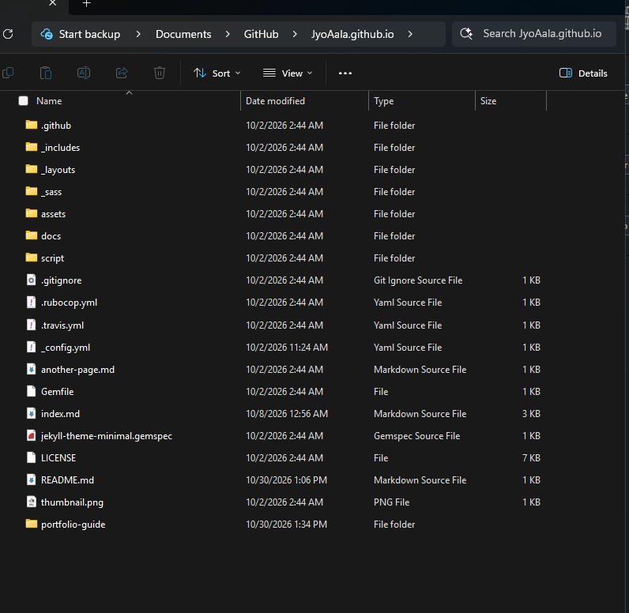
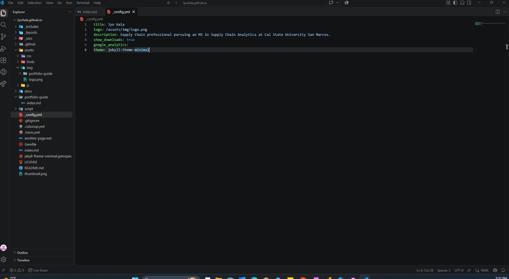
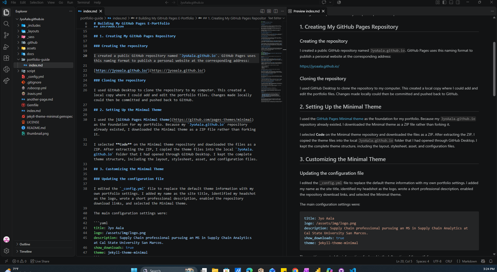
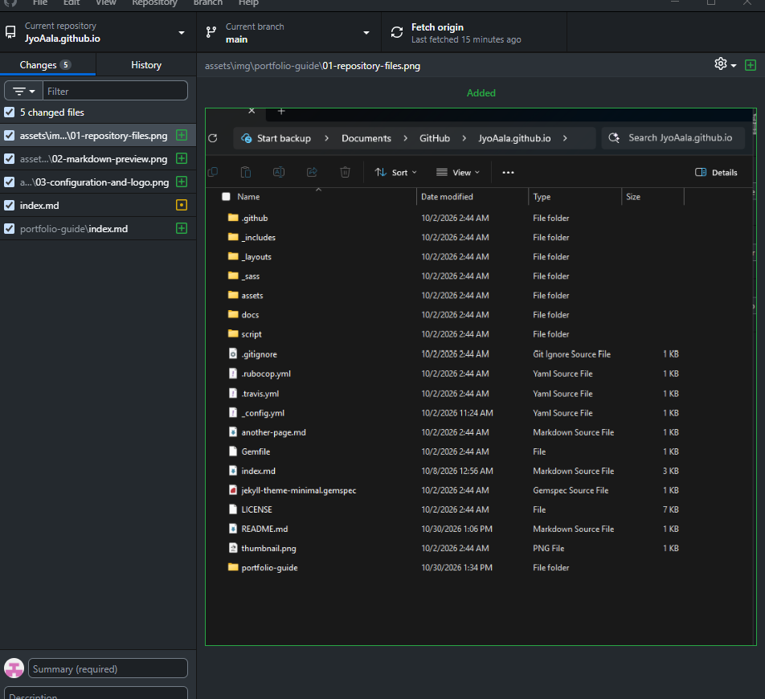

# Building My GitHub Pages E-Portfolio

## Introduction

I created this e-portfolio to present my professional experience, education, skills, and projects in one accessible location. I used GitHub Pages, Markdown, and the Minimal Jekyll theme to publish the website.

Before this project, I had limited experience creating websites with GitHub Pages. Completing the portfolio helped me understand how changes made on my computer become part of a live website.

This guide explains the process I followed, beginning with the creation of my GitHub Pages repository and ending with the publication of my completed professional portfolio.

## 1. Creating My GitHub Pages Repository

### Creating the repository

I created a public GitHub repository named `JyoAala.github.io`. GitHub Pages uses this naming format to publish a personal website at the corresponding address:

[https://jyoaala.github.io/](https://jyoaala.github.io/)

### Cloning the repository

I used GitHub Desktop to clone the repository to my computer. This created a local copy where I could add and edit the portfolio files. Changes made locally could then be committed and pushed back to GitHub.

## 2. Setting Up the Minimal Theme

I used the [GitHub Pages Minimal theme](https://github.com/pages-themes/minimal) as the foundation for my portfolio. Because my `JyoAala.github.io` repository already existed, I downloaded the Minimal theme as a ZIP file rather than forking it.

I selected **Code** on the Minimal theme repository and downloaded the files as a ZIP. After extracting the ZIP, I copied the theme files into the local `JyoAala.github.io` folder that I had opened through GitHub Desktop. I kept the complete theme structure, including the layout, stylesheet, asset, and configuration files.



*Figure 1. The complete Minimal theme files and the new portfolio-guide folder in my local GitHub Pages repository.*

## 3. Customizing the Minimal Theme

### Updating the configuration file

I edited the `_config.yml` file to replace the default theme information with my own portfolio settings. I added my name as the site title, identified my headshot as the logo, wrote a short professional description, enabled the repository download links, and selected the Minimal theme.

The main configuration settings were:

```yaml
title: Jyo Aala
logo: /assets/img/logo.png
description: Supply Chain professional pursuing an MS in Supply Chain Analytics at Cal State University San Marcos.
show_downloads: true
theme: jekyll-theme-minimal
```

These settings control the information displayed in the left section of the portfolio.



*Figure 2. My customized `_config.yml` settings and the `assets/img/logo.png` headshot file in Visual Studio Code.*

### Replacing the stock image

The Minimal theme included a stock image named `logo.png` in the `assets/img` folder. I replaced it with my professional headshot and retained the same filename. Keeping the filename allowed the theme to display my photograph without requiring additional changes to the layout.

### Rewriting the main portfolio page

I replaced the sample content in the root `index.md` file with my professional information. I organized the portfolio into sections covering my background, core strengths, professional experience, selected projects, education, skills, and professional links.

I used several Markdown elements to organize the content, including:

- Level 1, 2, and 3 headings
- Bold and italic text
- Ordered and unordered lists
- Hyperlinks
- Inline code

Using Markdown allowed me to structure the content without writing HTML.

## 4. Reviewing the Portfolio in VS Code

While preparing this guide, I used Visual Studio Code to review and edit my Markdown files. The Markdown Preview feature allowed me to compare the Markdown syntax with the formatted version of the page. This helped me check the headings, lists, links, and spacing before publishing the changes.



*Figure 3. The portfolio-guide Markdown source and formatted Markdown Preview displayed side by side in Visual Studio Code.*

## 5. Committing and Publishing the Portfolio

### Reviewing the changes

After completing the portfolio files, I returned to GitHub Desktop and reviewed the list of changed files. This helped me confirm which files would be included in the commit.



*Figure 4. GitHub Desktop showing the files added and modified for the Milestone II portfolio guide.*

### Committing and pushing the files

I entered a short summary of my changes and committed them to the `main` branch. I then selected **Push origin** to upload the files from my computer to GitHub.

Because the repository was named `JyoAala.github.io`, GitHub Pages used the repository files to build and publish my website.

## 6. Verifying the GitHub Pages Deployment

After pushing the changes, I opened the **Actions** tab in my GitHub repository. I located the workflow named **pages build and deployment** and confirmed that it completed successfully with a green checkmark.

I then visited my published portfolio to make sure the headshot, professional information, headings, lists, and links appeared correctly.

## 7. Final E-Portfolio

My completed professional e-portfolio is available here:

[View my professional e-portfolio](https://jyoaala.github.io/)

The portfolio presents my professional background, supply chain and contract management experience, education, selected projects, technical skills, and professional links.

## Resources

I used the following resources while building and reviewing my portfolio:

- [GitHub Pages documentation](https://docs.github.com/en/pages)
- [GitHub Pages Minimal theme](https://github.com/pages-themes/minimal)
- [GitHub Desktop documentation](https://docs.github.com/en/desktop)
- [Basic Markdown syntax](https://www.markdownguide.org/basic-syntax/)
- [Visual Studio Code Markdown Preview](https://code.visualstudio.com/docs/languages/markdown#_markdown-preview)

## Conclusion

This project helped me understand how GitHub repositories, Markdown, Jekyll themes, and GitHub Pages work together. I learned how to edit files locally, record changes with commits, push updates to GitHub, and confirm a website deployment through GitHub Actions.

The completed portfolio gives me one location where I can present my professional experience, education, projects, and developing supply chain analytics skills.